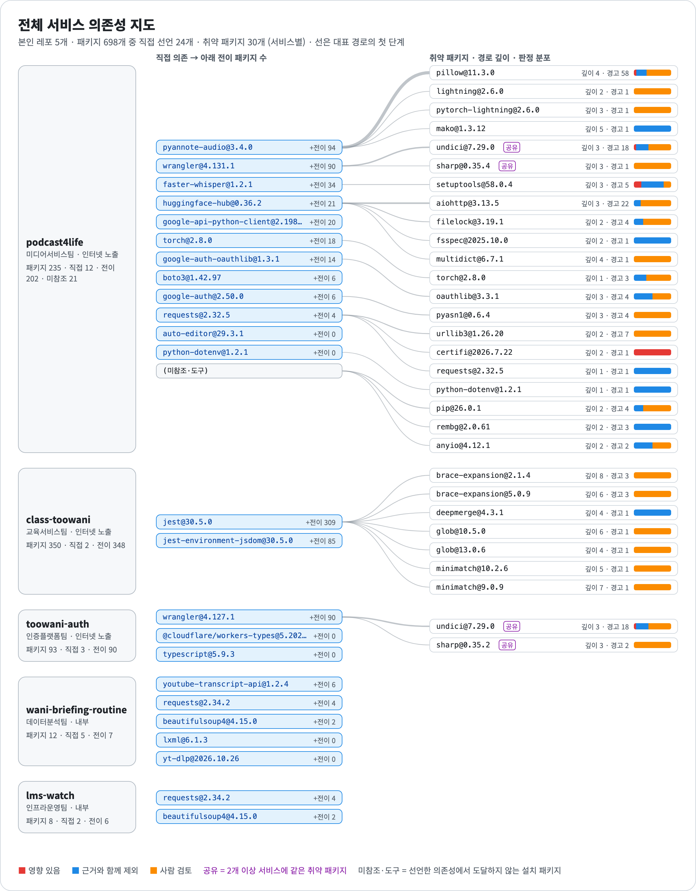
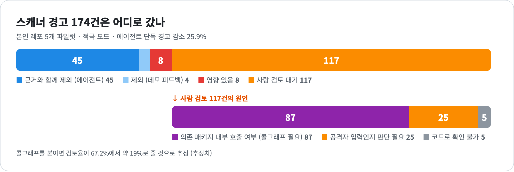
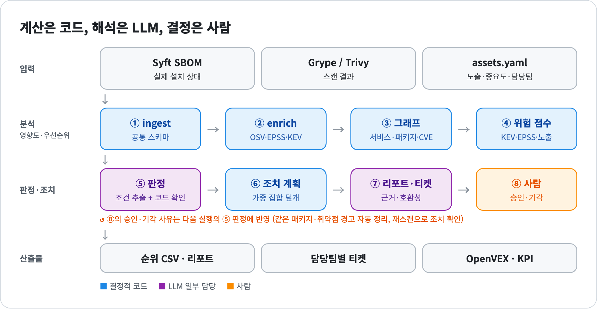
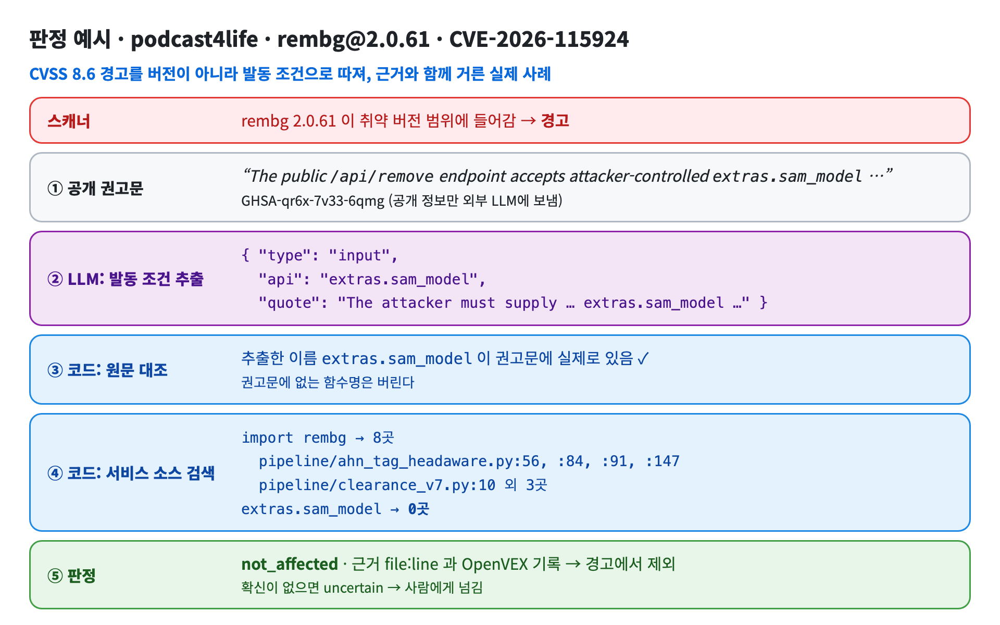
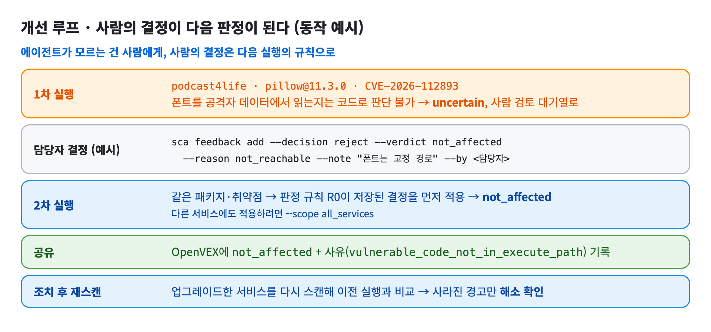
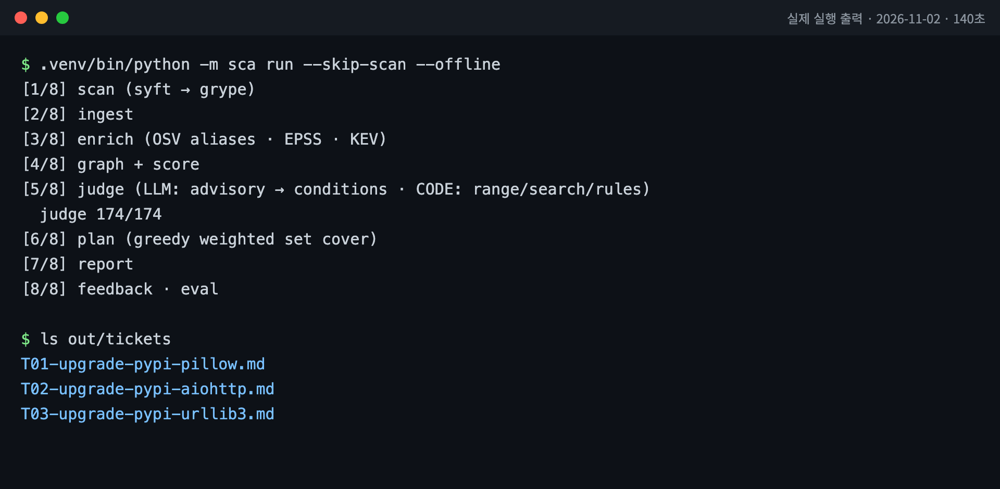

# SW 공급망 스캐닝 AI 에이전트

> SBOM과 취약점 스캔 결과를 **서비스 영향도·우선순위**로 잇고, 공개 권고문의 발동 조건을 코드에서 확인해 **근거와 함께 경고를 거른 뒤**, 조치안과 사람 피드백 루프로 닫는 에이전트.
> LOTTE AX Challenge 2026 · 롯데이노베이트 [인프라] 과제 예선 PoC

  -6f42c1) 

## 왜 만들었나

### 문제의식: 스캐너는 "찾기"까지만 해 준다

- **보이지 않는 부품이 대부분이다.** 파일럿 서비스 5개에 실제로 설치된 패키지 698개 중 개발자가 직접 선언한 것은 24개(3.4%)다. 취약 패키지 30개 중 27개도 선언하지 않은 부품이다. Log4Shell 때 "우리 어느 서비스에 들어 있나"를 찾는 데 오래 걸린 이유와 같다.
- **경고는 많고, 진짜 위험은 적다.** 스캐너는 버전만 맞으면 경고하므로 이 파일럿에서만 174건이 나왔다. 표본 56건을 권고문과 코드로 따져 보니 실제 영향(affected)은 2건이었다(AI 라벨 초안 기준). 심각도(CVSS) 상위 10건과 실제 위험도 상위 10건은 절반만 겹쳤다.

### 풀려는 병목: 경고 한 건마다 사람이 권고문과 코드를 읽는 일

스캐너 다음 단계는 대부분 수작업이다. 담당자가 경고마다 ① 어느 서비스의 어떤 경로로 들어왔는지 찾고, ② 공개 권고문에서 발동 조건을 읽고, ③ 우리 코드가 그 조건을 쓰는지 뒤지고, ④ 고칠지 말지 정한다. 계열사가 많은 그룹 SI에서는 이 일이 서비스 수만큼 반복된다. 이 에이전트는 ①과 ③을 코드로, ②를 LLM으로 처리하고, 확신이 없는 건만 근거를 붙여 ④의 사람에게 넘긴다.

### 왜 내 프로젝트로 했나

- **실제로 운영 중인 서비스다.** SSO 인증 서버, 팟캐스트 편집·게시 파이프라인과 댓글 Worker, 수업 기록 사이트, 크론·배치 작업이다. 장난감 예제가 아니라 실제 lockfile과 설치 상태를 스캔했다.
- **그룹 SI의 축소판이다.** Python과 npm이 섞여 있고, 인터넷 노출과 내부 서비스, 담당 팀이 다르다. 각 서비스를 가상의 계열사 조직에 배정했다(`config/assets.yaml`).
- **정답을 확인할 수 있다.** 코드를 직접 알고 있어서 에이전트의 판정이 맞았는지 정답셋으로 검증할 수 있다. 롯데 내부 데이터는 예선에서 쓸 수 없으므로, 본선 현장 데이터가 오면 입력 파서(ingest)만 바꾼다.
- **내부 정보 보호를 실제로 시험한다.** 일부 레포가 비공개라서 "소스 코드와 자산 정보는 LLM에 보내지 않는다"는 설계를 그대로 적용해야 했다.

<p align="center"></p>

## 결과

| | 결과 (본인 레포 5개 파일럿) |
|---|---|
| 🔎 **거르기** | 경고 **174 → 129건** (에이전트 단독 25.9%, 걸러낸 건마다 `file:line` 근거와 OpenVEX 기록) |
| 🎯 **정확성** | 테스트셋에서 에이전트가 결정한 **8건 모두 정답**, 실제 위험을 잘못 거른 건 **0건** · 전체 정답 일치는 9/20(45%), 나머지는 사람에게 넘김 |
| 🛠 **고치기** | 업그레이드 **3건으로 잔여 위험 71.2%** 해소 (메이저 변경·Python 런타임 호환성 표시) |
| ⏱ **속도·재현성** | 건당 **22.7초** (LLM 캐시 없이 실측) · 캐시 없이 재실행해도 판정 **164/174건 일치** |

<p align="center"></p>

## 구조

<p align="center"></p>

| 단계 | 하는 일 | 위치 |
|---|---|---|
| ① ingest | SBOM·스캔 결과 → 공통 스키마. 입력 형식이 바뀌면 파서만 교체 (`kind: sbom`으로 SBOM + Grype/Trivy JSON만으로도 실행) | `sca/ingest/` |
| ② enrich | OSV 권고문, FIRST EPSS, CISA KEV (공개 ID만 외부 조회, 디스크 캐시) | `sca/enrich/` |
| ③ 그래프 | 같은 취약 부품을 쓰는 서비스 전체와 "서비스 → 직접 의존 → … → 취약 패키지" 경로 | `sca/graph/` |
| ④ 점수 | $risk = 100 \times likelihood \times impact$ (가중치는 가정, `config/scoring.yaml`) | `sca/score/` |
| ⑤ 판정 | 아래 그림 참고. 규칙 12개, 적극/보수 모드 | `sca/judge/` |
| ⑥ 조치 | 업그레이드·삭제 Top-k와 위험 감소율, 호환성 위험 | `sca/plan/` |
| ⑦ 리포트 | 순위 CSV, Markdown 리포트, 티켓 초안, 그래프 PNG, OpenVEX | `sca/report/` |
| ⑧ 피드백 | 승인·기각 사유 저장 → 같은 경고 자동 정리, 재스캔으로 조치 확인 | `sca/feedback/` |

## 판정 — LLM은 조건만 뽑고, 판정은 코드가

<p align="center"></p>

- **내부 정보 보호**: 외부 LLM에는 공개 권고문만 보낸다. 자산 정보와 소스 코드는 코드에서만 결합한다.
- **모델 교체**: OpenAI SDK + `base_url`. 기본은 로컬 Ollama(gpt-oss:20b), 환경변수로 OpenAI·사내 모델로 바꾼다(OpenAI 경로는 미검증).
- **모드**: 적극(기본) = 필수 조건 하나만 없어도 제외 · 보수 = 근거가 완전할 때만 제외 (경고 감소 12.1%).

## 개선 루프 — 사람의 결정이 다음 판정이 된다

<p align="center"></p>

사람 검토 117건 중 74%(87건)는 의존 패키지 내부 호출 여부 문제다. 콜그래프를 붙이면 검토율이 67.2%에서 약 19%로 줄 것으로 추정한다(추정치).

## 실행

<p align="center"></p>

```bash
brew install syft grype uv ollama && ollama pull gpt-oss:20b
uv venv --python 3.11 .venv && uv pip install -e '.[dev]'
cp config/services.example.yaml config/services.local.yaml   # 스캔할 레포 경로 입력
.venv/bin/python -m sca run                                  # → out/report.md
```

| 옵션 | 뜻 |
|---|---|
| `--skip-scan --offline` | 이전 스캔·캐시로 네트워크 없이 재실행 |
| `--judge-mode conservative` | 보수 모드 |
| `sca feedback add …` | 승인·기각 기록 → 다음 실행에 반영 |
| `sca review export / import` | 정답셋 사람 검수표(xlsx) |

파일럿 서비스 레포는 비공개라 이 레포만으로 결과를 그대로 재현할 수는 없다. 산출물은 `out/`에 커밋되어 있다.

## 산출물

| 파일 | 내용 |
|---|---|
| [`out/report.md`](out/report.md) | KPI, 판정 분포, 모드 비교, Top-3 조치, 사람 검토 대기열 |
| [`out/ranked.csv`](out/ranked.csv) | 위험 순위 (점수·판정·수정 버전·경로) |
| [`out/tickets/`](out/tickets) | 담당팀별 티켓 초안 (근거, 호환성 위험, 검증 명령) |
| [`out/vex.json`](out/vex.json) | OpenVEX v0.2.0 |
| [`out/metrics.json`](out/metrics.json) | KPI 원본 |
| [`docs/verification.md`](docs/verification.md) | AI 검증 에이전트 4회차 기록 |

## 한계

- 파일럿은 본인 레포 5개, 탐지 174건이다. 일반화된 수치가 아니다.
- 정답셋 56건(테스트 20 / 튜닝 36)은 AI 초안이고 본인 검수는 진행 중이다(현재 0/20건).
- 저장된 피드백 2건은 데모 기록이고, 파일럿에서 실제 조치로 해소된 사례는 아직 없다.
- 22.7초는 LLM 캐시 없이 한 번 재실행한 값이다(캐시를 쓰면 10.7초). 사람 처리 시간은 미측정.

## 로드맵

콜그래프 연동 → PR 게이트(새 위험만 코멘트·차단) → 샌드박스 테스트 후 자동 PR → 펌웨어/HBOM
