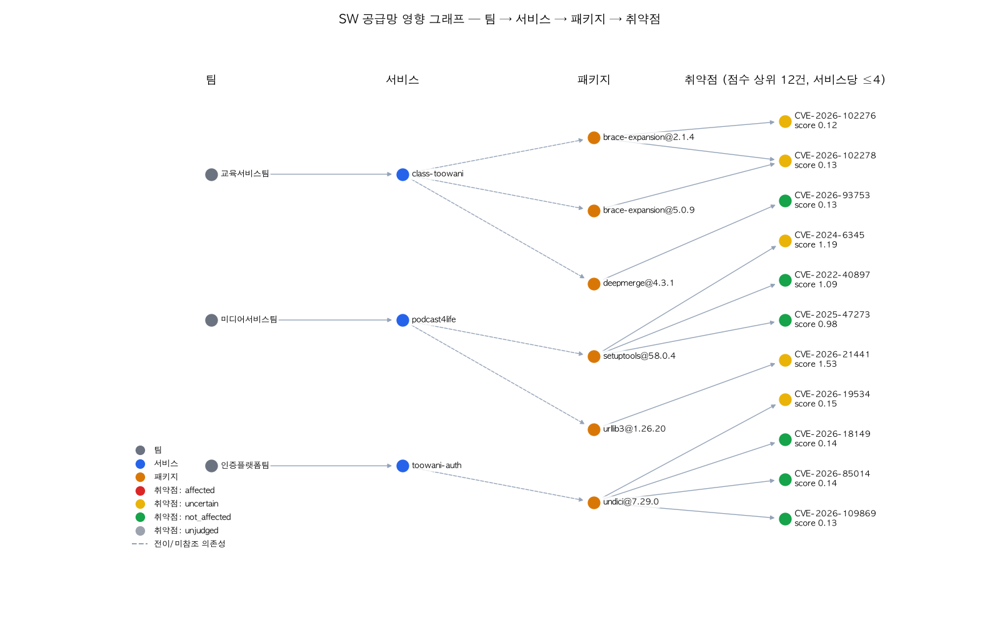

# SW 공급망 스캐닝 리포트

## 실행 정보
- 실행 시각: 2026-11-01T03:00:50Z · 소요 95.6s
- 범위: 본인 레포 5개 파일럿 (가상의 계열사 서비스) · 패키지 628개 · 고유 취약점 150개 · 탐지 행 174
- 도구: syft 1.55.0 · grype 0.121.0 (DB 2026-10-31T06:18:17Z) · KEV 2026.10.30 · EPSS 2026-10-31T14:47:05Z
- 판정 LLM: gpt-oss:20b@local (공개 권고문만 입력, 내부 자산 정보는 코드로만 결합)

## 핵심 지표
| 지표 | 값 | 산출 근거 |
|---|---|---|
| 경고 감소율 (에이전트 단독) | 25.9% | 시연용 데모 결정 2건(demo-reviewer, 실제 검토 아님)으로 처리된 4행 제외: not_affected 45 / 판정 174 |
| 경고 감소율 (데모 결정 포함) | 28.2% | 시연용 데모 결정 2건(demo-reviewer, 실제 검토 아님)으로 처리된 4행 포함: not_affected 49 / 판정 174 (스캐너 탐지 174) |
| 경고 감소율 (고유 취약점 기준) | 28.7% | 43 / 150 · 데모 결정 포함 |
| 조건 판정 정확도 (테스트셋) | 45.0% | 매칭 20건 중 정답 9건 · 사람 검수 0/20 · 다수 클래스(전부 not_affected) 기준선 85.0% |
| 판정한 건의 정밀도 (테스트셋) | 100.0% | uncertain 제외 8건 중 정답 8건 · 보류(사람에게) 12건 · 정답 라벨은 AI 초안(사람 검수 0/20) |
| 조건 판정 정확도 (튜닝셋) | 22.2% | 규칙 개선에 사용한 세트 36건 — 참고용 |
| Top-3 업그레이드 위험 커버율 | 71.2% | 상위 3개 조치 18.142 / 잔여 위험 25.481 · 계획 전체(k=3) 71.2% |
| 사람 검토 비율 | 67.2% | uncertain 117 / 판정 174 |
| 에이전트 처리 시간 (건당) | 10.66s | 중앙값 10.60s · 174/174건 캐시 사용(판정 캐시 174, LLM 조건 캐시 170) — 콜드 실행 시간은 캐시 삭제 후 재측정 · 4건은 0.05s 미만(LLM 호출 없는 규칙 판정 포함) |
| 사람 처리 시간 (건당) | 미측정 | data/eval/human_timing.yaml 기록 후 계산 |
| 속도 향상 | 미산출 | 사람 시간 측정 후 |

**판정 모드 비교** (같은 입력, 규칙만 다름 · 현재 모드: proactive)

| 모드 | 경고 감소율(에이전트 단독) | 사람 검토 비율 | 테스트셋 정확도 | 판정한 건 정밀도 | 놓친 affected |
|---|---|---|---|---|---|
| proactive | 25.9% | 67.2% | 45.0% | 100.0% (8건) | 0 |
| conservative | 12.1% | 81.0% | 25.0% | 100.0% (4건) | 0 |

## 판정 분포 (판정 × 규칙)
| 규칙 | affected | not_affected | uncertain | 합계 |
|---|---|---|---|---|
| api_not_referenced | 0 | 40 | 0 | 40 |
| condition_not_checkable | 0 | 0 | 5 | 5 |
| condition_symbol_in_code | 4 | 0 | 0 | 4 |
| feedback_suppressed | 0 | 4 | 0 | 4 |
| input_trust_needs_human | 0 | 0 | 25 | 25 |
| platform_excluded | 0 | 5 | 0 | 5 |
| reachable_via_dependency | 0 | 0 | 63 | 63 |
| transitive_needs_callgraph | 0 | 0 | 24 | 24 |
| unconditional_version_match | 4 | 0 | 0 | 4 |
| **합계** | 8 | 49 | 117 | 174 |

결정 주체: code 170 · feedback 4 (데모 기록)

feedback_suppressed 4행은 시연용 데모 결정 2건(demo-reviewer)으로 처리됐습니다. 실제 사람 검토가 아닙니다.
테스트셋 혼동 행렬 (행: 정답, 열: 판정, 매칭 20/20건)

| 정답 \ 판정 | affected | not_affected | uncertain |
|---|---|---|---|
| affected | 1 | 0 | 1 |
| not_affected | 0 | 7 | 10 |
| uncertain | 0 | 0 | 1 |

## 업그레이드 Top-3
| # | 조치 | 서비스 | 해소 행 | 위험 감소 | 비중 | 호환성 위험 |
|---|---|---|---|---|---|---|
| 1 | pypi:pillow 11.3.0 → 13.0.0 | podcast4life | 42 | 11.545 | 45.3% | 메이저 · 런타임(Python 3.9.6 → >=3.11) |
| 2 | pypi:aiohttp 3.13.5 → 3.14.4 | podcast4life | 18 | 3.729 | 14.6% | 런타임(Python 3.9.6 → >=3.10) |
| 3 | pypi:urllib3 1.26.20 → 2.8.0 | podcast4life | 7 | 2.868 | 11.3% | 메이저 |

호환성 위험: 메이저 = semver 메이저 버전 변경 · 런타임 = 목표 버전의 Requires-Python이 서비스 Python과 맞지 않음

Top-3 위험 커버율: **71.2%** · 계획 전체 k=3: 71.2% · 수정 불가/삭제 불가 1건

## 사람 검토 대기열 (117건)
117건 중 종합 점수 상위 20건. 전체 목록은 `out/ranked.csv`(verdict = uncertain). 조건 열은 LLM이 권고문에서 뽑은 영문 원문입니다.

| 서비스 | 패키지 | 취약점 | 점수 | 사유(규칙) | 조건/검색 |
|---|---|---|---|---|---|
| podcast4life | pypi:urllib3@1.26.20 | CVE-2026-21441 | 1.534 | reachable_via_dependency | [api] The application must use urllib3's streaming API (e.g., call the stream method). (symbols: stream); [config] The… |
| podcast4life | pypi:setuptools@58.0.4 | CVE-2024-6345 | 1.194 | transitive_needs_callgraph | [input] The application must provide a user‑controlled package URL to the download function. |
| podcast4life | pypi:pillow@11.3.0 | CVE-2026-112900 | 0.894 | input_trust_needs_human | [input] The application must open an EPS file whose filename begins with a dash or at-sign, allowing argument… |
| podcast4life | pypi:pillow@11.3.0 | CVE-2026-112393 | 0.699 | reachable_via_dependency | [api] The application must call Image.save() with a BytesIO (or other in‑memory) target. (symbols: Image.save… |
| podcast4life | pypi:pillow@11.3.0 | CVE-2026-112398 | 0.477 | input_trust_needs_human | [feature] The optional olefile dependency must be installed. (symbols: olefile); [api] The application must call… |
| podcast4life | pypi:pillow@11.3.0 | CVE-2026-96639 | 0.452 | input_trust_needs_human | [api] The application must use Pillow's ImageSequence.Iterator and call frame.load() to process multiple frames.… |
| podcast4life | pypi:pillow@11.3.0 | CVE-2026-112396 | 0.364 | input_trust_needs_human | [input] The application must re‑encode an attacker‑controlled image to TIFF in an in‑memory buffer. (symbols… |
| podcast4life | pypi:urllib3@1.26.20 | CVE-2025-66418 | 0.358 | transitive_needs_callgraph | [config] Content decoding must be enabled for the vulnerability to be exploitable. |
| podcast4life | pypi:urllib3@1.26.20 | CVE-2025-66471 | 0.358 | reachable_via_dependency | [api] The application must call a streaming method of urllib3.HTTPResponse. (symbols: stream, read, read1… |
| podcast4life | pypi:pillow@11.3.0 | CVE-2026-40192 | 0.352 | reachable_via_dependency | [input] The application must open a FITS image. (symbols: FITS) |
| podcast4life | pypi:lightning@2.6.0 | CVE-2026-58659 | 0.342 | reachable_via_dependency | [api] The application must call LightningModule.load_from_checkpoint. (symbols: LightningModule.load_from_checkpoint)… |
| podcast4life | pypi:pillow@11.3.0 | CVE-2026-112401 | 0.341 | input_trust_needs_human | [api] The application must call Pillow's Image.open() to load the image. (symbols: Image.open); [input] The input… |
| podcast4life | pypi:pillow@11.3.0 | CVE-2026-54058 | 0.332 | reachable_via_dependency | [api] The application must use Pillow's McIdasImagePlugin to open a file. (symbols: McIdasImagePlugin._open); [input]… |
| podcast4life | pypi:pillow@11.3.0 | CVE-2026-112394 | 0.319 | reachable_via_dependency | [input] The application must call Image.frombytes with raw mode "P;2L" or "P;4L" and provide a buffer that is too… |
| podcast4life | pypi:pillow@11.3.0 | CVE-2026-96640 | 0.317 | input_trust_needs_human | [api] The application must call Image.save with format="PDF" and append=True. (symbols: Image.save); [input] The… |
| podcast4life | pypi:pillow@11.3.0 | CVE-2026-112400 | 0.312 | condition_not_checkable | [other] The application must catch the DecompressionBombError raised during GIF frame seeking and then continue using… |
| podcast4life | pypi:pillow@11.3.0 | CVE-2026-112402 | 0.312 | reachable_via_dependency | [input] The attacker must supply an oversized output size to Image.transform() that causes a calloc failure. (symbols… |
| podcast4life | pypi:pillow@11.3.0 | CVE-2026-112390 | 0.311 | reachable_via_dependency | [feature] The optional olefile package must be installed. (symbols: olefile); [api] The application must call the… |
| podcast4life | pypi:pillow@11.3.0 | CVE-2026-112391 | 0.305 | input_trust_needs_human | [api] The application must call Image.save with format="PDF" and append=True. (symbols: Image.save, format, append)… |
| podcast4life | pypi:pillow@11.3.0 | CVE-2026-112397 | 0.301 | input_trust_needs_human | [input] The application must provide an image with a declared width of 0.; [api] The application must invoke the… |

## 종합 위험 Top-10
| # | 서비스 | 팀 | 패키지 | 의존 | 취약점 | CVSS | EPSS | KEV | 점수 | 판정 | 수정 버전 |
|---|---|---|---|---|---|---|---|---|---|---|---|
| 1 | podcast4life | 미디어서비스팀 | urllib3@1.26.20 | 전이 | CVE-2026-21441 | 7.5 | 0.02922 |  | 1.534 | 보류(사람) | 2.6.3 |
| 2 | podcast4life | 미디어서비스팀 | setuptools@58.0.4 | 전이 | CVE-2024-6345 | 8.8 | 0.01939 |  | 1.194 | 보류(사람) | 70.0.0 |
| 3 | podcast4life | 미디어서비스팀 | setuptools@58.0.4 | 전이 | CVE-2022-40897 | 5.9 | 0.02632 |  | 1.087 | 영향 없음 | 65.5.1 |
| 4 | podcast4life | 미디어서비스팀 | setuptools@58.0.4 | 전이 | CVE-2025-47273 | 8.8 | 0.01592 |  | 0.981 | 영향 없음 | 78.1.1 |
| 5 | podcast4life | 미디어서비스팀 | pillow@11.3.0 | 전이 | CVE-2026-112900 | 9.8 | 0.01303 |  | 0.894 | 보류(사람) | 13.0.0 |
| 6 | podcast4life | 미디어서비스팀 | pillow@11.3.0 | 전이 | CVE-2026-112393 | 9.8 | 0.01019 |  | 0.699 | 보류(사람) | 13.0.0 |
| 7 | podcast4life | 미디어서비스팀 | pillow@11.3.0 | 전이 | CVE-2026-112403 | 9.8 | 0.00945 |  | 0.648 | 영향 없음 | 13.0.0 |
| 8 | podcast4life | 미디어서비스팀 | pillow@11.3.0 | 전이 | CVE-2026-112398 | 9.8 | 0.00696 |  | 0.477 | 보류(사람) | 13.0.0 |
| 9 | podcast4life | 미디어서비스팀 | pillow@11.3.0 | 전이 | CVE-2026-96639 | 9.8 | 0.00659 |  | 0.452 | 보류(사람) | 13.0.0 |
| 10 | podcast4life | 미디어서비스팀 | pillow@11.3.0 | 전이 | CVE-2026-112396 | 7.5 | 0.00694 |  | 0.364 | 보류(사람) | 13.0.0 |

## 영향 그래프

## 조치 티켓 (3건)
- [T01-upgrade-pypi-pillow](tickets/T01-upgrade-pypi-pillow.md)
- [T02-upgrade-pypi-aiohttp](tickets/T02-upgrade-pypi-aiohttp.md)
- [T03-upgrade-pypi-urllib3](tickets/T03-upgrade-pypi-urllib3.md)
